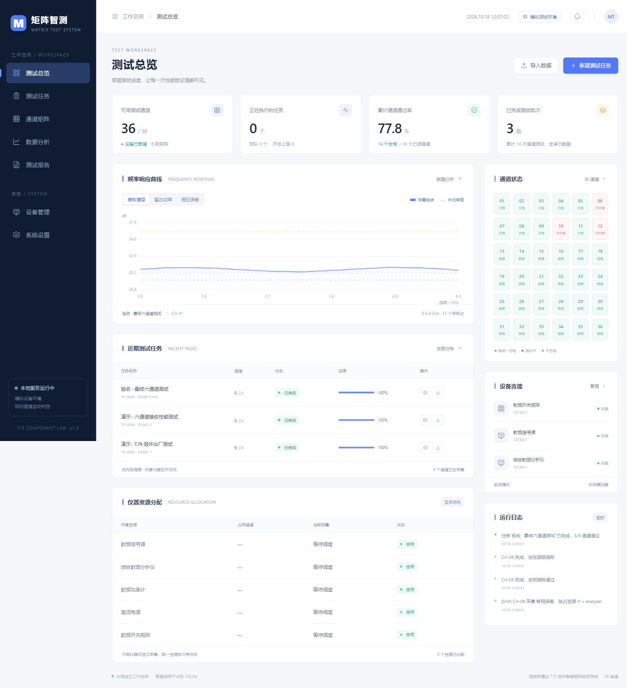

# 矩阵智测 · T/R 组件智能矩阵测试系统

这是根据四页设计 PPT 实现的本地软件项目，包含浏览器控制台、测试调度服务、独立通道采集线程、SQLite 数据库和演示设备。



## 启动

需要 **Node.js 24 或更新版本**，不需要安装第三方依赖。

Windows 下双击 **`启动测试系统.cmd`**。脚本会寻找 Node.js、启动本地服务，并在浏览器打开控制台。默认地址：

<http://127.0.0.1:4318>

也可在此文件夹打开终端运行：

```powershell
node server.mjs
```

首次启动自动创建 2 批明确标记的演示报告。服务默认仅监听 `127.0.0.1`。关闭启动窗口或在终端按 Ctrl+C 结束服务。

## 使用流程

1. 打开“设备管理”，确认模拟设备已连接。
2. 点击“新建测试任务”，选择通道、指标、优先级和扫描频段。
3. 在“测试任务”观察进度，可暂停、继续或取消。暂停会保存已完成指标的检查点并释放资源，继续时接着采集未完成指标。
4. “通道矩阵”显示每个通道状态，支持创建单通道手动测试。
5. 在“数据分析”切换批次与通道，查看频率响应、测量值、上下限与判定结果。
6. 在“测试报告”查看记录、下载 CSV。导出的数据包含指标值、单位、阈值和来源标记。
7. “系统设置”支持 1～6 级矩阵、6～36 通道、并发上限及逐项阈值。新阈值用于新任务，历史结果保留原阈值。

## 已实现的内容

- 优先级任务队列，高优先级优先使用空闲线程，同级按创建时间排序。
- 通道采集使用 Worker Threads，同一物理通道不会被两个任务同时占用。
- 采集前获取共享仪器互斥锁，不冲突的仪器资源可以并行工作。
- 暂停、恢复、取消、设备断开恢复与重启后的未完成任务恢复。
- 覆盖总体、发射、接收指标，补充电压、电流指标。阈值初始值为演示配置。
- SSE 实时状态、采样曲线、指标明细、日志及 CSV 导入导出。
- 任务、配置、测量结果和日志保存至本机 `data/radar.sqlite`。

## CSV 导入

在控制台中可下载示例。采用 UTF-8 编码，每行是一组频率采样：

```csv
channelId,serial,frequency,gain,outputPower,phaseError,noiseFigure,vswr
1,TR-001,0.5,32.1,30.2,1.5,2.3,1.2
1,TR-001,6.0,32.4,30.1,1.7,2.4,1.3
```

`channelId` 为当前启用通道编号，`frequency` 单位为 GHz，`serial` 为组件序列号。至少需要一个已知测量指标列。同一通道若有任意采样点超限，该指标即判为不合格。测量列的英文标识见 `lib/metrics.mjs`。导入数据保留 `IMPORTED` 来源，与 `SIMULATED` 模拟结果区分。

## 真实仪器与模型接入

当前版本提供**完整可运行的模拟采集与规则判定流程**。设备地址、端口和启用状态可以保存，连接按钮控制模拟设备；不会向该地址发起真实仪器指令。

真实硬件需要仪器型号、矩阵通道路由表、厂家协议、驱动和校准信息。YOLOv5 性能评估需要标注波形数据、训练权重、预处理规范和验证集。这些材料未包含在 PPT 中，因此本项目没有声称已实现训练模型、真实硬件控制或 PPT 中的错误率和效率指标。烧毁峰值功率仅模拟，不执行破坏性实测。

详细的 PPT 需求映射、系统设计和接口接入方案见 [需求与设计](docs/需求与设计.md)。

## 目录

```text
server.mjs                  本地 HTTP / API / SSE 服务
lib/system.mjs              调度、资源互斥、持久保存与任务生命周期
lib/acquisition-worker.mjs   独立通道采集线程
lib/metrics.mjs              指标、演示阈值与可重复模拟采样
lib/csv.mjs                  CSV 解析、规则评估和安全导出
public/                     控制台界面、曲线与样式
tests/                      自动化测试
docs/                       需求与设计、验收记录和示例数据
data/                       首次运行后生成的本地数据库
```

## 验证

```powershell
node --test --test-isolation=none tests/*.test.mjs
```

测试使用临时数据库，覆盖调度优先级、物理通道互斥、仪器锁、暂停恢复、设备掉线、并发上限、36 通道执行、持久保存、历史阈值及 CSV 异常数据。`docs/验收记录.md` 记录本次交付的实际验证结果。

可用 `PORT` 环境变量修改端口，默认 `4318`。请保留数据库文件以保存历史结果，复制或备份数据库前先停止服务。

## 仓库内容

仓库包含软件源码、界面截图、需求文档、示例 CSV 和自动化测试。本地数据库、测试临时文件、环境变量文件及原 PPT 嵌入图片不提交到版本库。克隆项目后首次启动会重新建立本机数据库与演示记录。
